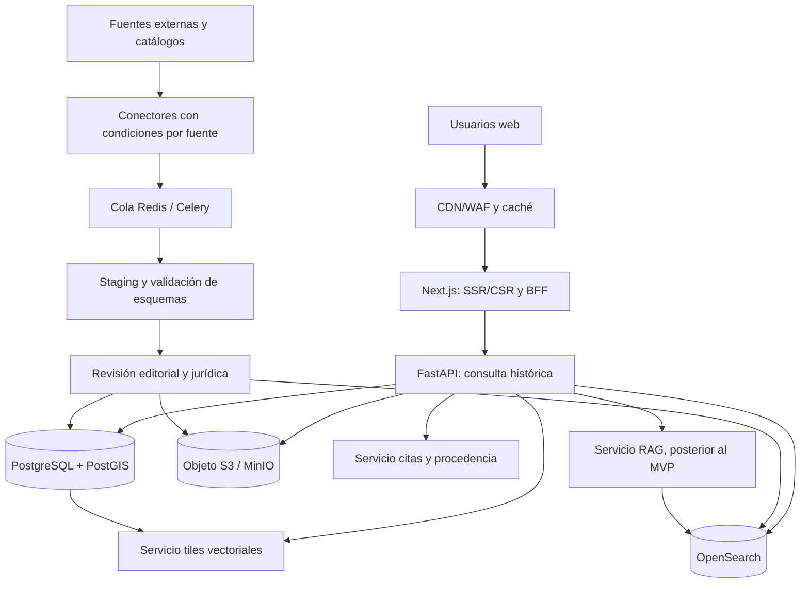

# ESPAÑA: MEMORIA VIVA

## Documento maestro de producto, diseño, arquitectura y fuentes históricas

**Código:** EMV-MASTER-001  
**Versión:** 1.1 (revisión crítica, stack, auditoría de fuentes y roadmap)  
**Fecha:** 14 de noviembre de 2026  
**Estado:** Base de trabajo para un proyecto personal público de un solo autor; no constituye validación jurídica o editorial definitiva. Cambios respecto a la v1.0 al final del documento.

> **Propósito.** Construir una plataforma pública para explorar, comprender e investigar la historia contemporánea de España mediante cartografía, cronologías, fuentes primarias, estadísticas y narrativas visuales, con especial atención a la Segunda República, la Guerra Civil y la dictadura franquista.

## 0. Resumen ejecutivo integrado

**Horizonte histórico:** 1874–1978. El proyecto se estructura en antecedentes de la República (1874–1931), Segunda República (1931–1936), golpe de Estado y Guerra Civil (1936–1939), posguerra y consolidación de la dictadura (1939–1959), transformaciones del franquismo tardío (1959–1975) y Transición constitucional (1975–1978).

**Producto central:** atlas geoespacial temporal conectado con cronología, fichas documentales, indicadores comparables, narrativas verificadas y buscador. Las recreaciones 3D y los asistentes de IA amplían el sistema, pero no sustituyen las fuentes primarias.

**Principio rector:** cada objeto histórico público expone al menos identificación de fuente, fecha o intervalo, ámbito espacial, procedencia, grado de certidumbre, derechos y vínculo al custodio o bibliografía. Los registros nominales nunca se fusionan automáticamente por similitud de nombre.

**Piloto propuesto:** España 1931–1939, con cobertura nacional por provincia (50 provincias del periodo) allí donde las series permitan comparación. La demostración municipal detallada pasa a fase posterior, sujeta a disponibilidad real de documentos y permisos.

**Stack del MVP (v1.1):** sitio estático con Astro y TypeScript; MapLibre GL + PMTiles para cartografía; ECharts para indicadores; GSAP para narrativa; Pagefind para búsqueda; datos JSON/GeoJSON versionados en Git y validados con JSON Schema; ETL en Python + DuckDB; GitHub Pages. El stack institucional (FastAPI, PostgreSQL/PostGIS, OpenSearch, S3/MinIO, Celery, RAG) queda como arquitectura objetivo y solo se adopta si se cumplen los criterios de escalado de `docs/02_stack.md`.

**Fuentes:** inventario de 31 conjuntos o instituciones candidatas, auditado el 14-11-2026 (`docs/03_auditoria_fuentes.md` y `docs/source_registry.csv`). Hallazgos clave: la API del INE no tiene datos anteriores a 1981; la API del BOE empieza en septiembre de 1960 y el periodo se consulta en la colección Gazeta; la Hemeroteca de la BNE prohíbe agentes automáticos en su web, pero publica texto completo en datos.gob.es con licencia CC BY 4.0.

**Decisiones de producto ya recomendadas:** mantener plataforma web accesible sin WebGL obligatorio; no inferir ausencias documentales como inexistencia histórica; comparar series solo con advertencias metodológicas; distinguir hechos documentados, interpretaciones historiográficas, testimonios y reconstrucciones; preservar textos de origen junto a normalizaciones.

### Orden de trabajo y entregables

| Etapa | Entregable | Puerta de salida |
|---|---|---|
| 0. Gobierno y diseño | Manual editorial, IA/UX, wireframes, ADR, inventario de licencias | Responsables y criterios aprobados |
| 1. Datos de referencia | Modelo canónico, geografía temporal, registro de fuentes y pipeline piloto | 100 fichas trazables; cero publicación sin derechos |
| 2. MVP | Atlas, cronología, archivo, series y narrativas | Cinco recorridos revisados; fuentes citadas; accesibilidad probada |
| 3. Ampliación | Personas, corpus temático, IA asistida, API | Evaluación de privacidad y fidelidad documental |
| 4. Inmersión | Museo, reconstrucciones 3D y aulas | Reconstrucción etiquetada y basada en expediente de evidencias |

### Reglas editoriales transversales

1. La fidelidad a los documentos no implica aceptar como hechos verdaderos todas las afirmaciones contenidas en ellos; cada documento debe contextualizarse.
2. Se describirán la violencia y represión ejercidas por diferentes actores según la evidencia disponible, distinguiendo periodos, agentes, mecanismos y carácter institucional.
3. La ausencia de documentos no prueba ausencia de acontecimientos; la cobertura desigual se mostrará gráficamente.
4. Los indicadores numéricos mostrarán población, denominador, unidad, recuento, periodo, geografía, fuente y comparabilidad cuando aplique.
5. Las coordenadas de lugares sensibles y los datos personales de víctimas o familiares se publicarán solo tras evaluación específica.
6. Los asistentes de IA citarán fuentes recuperadas y podrán abstenerse cuando no exista evidencia suficiente.

### Mapa de este documento

**Parte I** establece visión, requisitos, público, dominios, módulos, alcance y métricas. **Parte II** concreta arquitectura de información, pantallas, sistemas técnicos, APIs y ejecución. **Parte III** incorpora el inventario completo de 30 fuentes históricas, derechos, riesgos, integración y plan de validación. **Parte IV** cierra con decisiones y control de cambios.

---

# Parte I — PRD y requisitos de producto

**Versión:** 1.0  
**Fecha:** 14-11-2026  
**Estado:** propuesta de definición, pendiente de revisión historiográfica, jurídica y técnica  
**Horizonte histórico:** 1874–1978; prioridad editorial 1931–1975.

### 1. Resumen ejecutivo
España: Memoria Viva es una plataforma abierta de historia documental, geoespacial e interactiva. Une fuentes primarias, historiografía, estadísticas, mapas, prensa, fotografías y testimonios mediante un atlas temporal, búsquedas explicables, narrativas y experiencias 3D claramente etiquetadas como recreaciones. La plataforma no sustituye a los archivos custodios ni proclama exhaustividad.

### 2. Problema y oportunidad
Los materiales de historia contemporánea española se encuentran dispersos entre repositorios públicos, hemerotecas, archivos, instituciones académicas y colecciones particulares, con coberturas, catálogos, denominaciones y condiciones jurídicas heterogéneas. Una interfaz temporal y territorial que conserve procedencia y contexto reduce la fricción para estudiar, enseñar y contrastar acontecimientos.

### 3. Objetivos y límites
**Objetivos:** descubrimiento transversal de documentos; consulta geográfica y cronológica; comparación de indicadores con metadatos metodológicos; experiencias educativas accesibles; interoperabilidad y API; conservación de trazabilidad y revisión humana.
**No objetivos del MVP:** reconstrucción total de España en 3D; digitalización masiva de archivos ajenos; identificación biométrica de personas; generación de testimonios ficticios presentados como reales; replicación indiscriminada de fondos con derechos; afirmación de cobertura exhaustiva de víctimas.

### 4. Audiencias
- Público general: historias contextualizadas y verificables.
- Docentes y estudiantes: itinerarios didácticos, mapas, actividades y bibliografía.
- Historiadores y periodistas: búsqueda avanzada, comparación, exportación y cita.
- Familias: búsqueda de expedientes de personas con privacidad y prevención de confusiones.
- Archivos, museos y asociaciones: colecciones y aportaciones revisables.

### 5. Marco temporal y narrativo
- 1874–1931: Restauración, cambios socioeconómicos, crisis de la monarquía y Primo de Rivera.
- 1931–1936: Segunda República, políticas públicas, derechos, conflictividad y transformaciones sociales.
- 1936–1939: golpe militar, Guerra Civil, frentes, bombardeos, violencia en retaguardias, exilio y daños.
- 1939–1959: posguerra, represión institucional, autarquía, subsistencia, resistencia y vida cotidiana.
- 1959–1975: transformación económica, migración, movilización social, oposición y últimos años del franquismo.
- 1975–1978: transición hasta la Constitución.
Registrar calendarios, cambios territoriales, topónimos históricos y fechas inciertas; evitar atribuciones causales simplistas.

### 6. Dominios de contenido
Política e instituciones; elecciones; legislación; demografía; agricultura e industria; precios y salarios; desigualdad y trabajo; educación y alfabetización; salud y vida cotidiana; prensa y censura; patrimonio y cultura; religión y género; guerra y operaciones; violencia y represión; justicia y cárceles; fosas y exhumaciones; deportaciones; exilio y migraciones; resistencias; infraestructuras y transformación urbana.
Cada dominio debe indicar cobertura territorial y temporal, granularidad, sesgos de conservación, definiciones estadísticas y lagunas.

### 7. Módulos y requisitos
#### M01 Atlas geoespacial (P0)
- RF-001: mapa histórico por año o intervalo 1874–1978; barra temporal sincronizada.
- RF-002: capas de provincias, municipios, topónimos, acontecimientos y puntos documentales según disponibilidad.
- RF-003: diferenciación entre geometrías históricas y actuales; procedencia cartográfica.
- RF-004: selección de territorio con documentos, indicadores y eventos relacionados.
- RF-005: capas sensibles con advertencias, incertidumbre espacial y controles de exposición.
#### M02 Cronología (P0)
- RF-006: acontecimientos con fecha exacta, aproximada o rango y precisión declarada.
- RF-007: vistas general y temáticas; navegación por década/año/mes cuando haya datos.
- RF-008: comparación entre dos fechas sin inferir datos intermedios no observados.
#### M03 Archivo (P0)
- RF-009: ficha con título, custodio, fondo, signatura, URL persistente, fecha, licencia, restricciones y contexto.
- RF-010: imagen/visualizador solo si el permiso lo habilita; de lo contrario enlace al custodio.
- RF-011: reconocimiento de texto OCR/HTR siempre marcado como transcripción automática o validada.
#### M04 Estadísticas (P0)
- RF-012: indicadores comparables con unidad, población de referencia, metodología y fuente.
- RF-013: gráficos con notas de discontinuidad, sesgo y ausencia de datos.
- RF-014: descarga CSV/JSON con atribución cuando lo permitan las condiciones.
#### M05 Búsqueda federada (P0)
- RF-015: búsquedas por texto, persona, lugar, periodo, tema, custodio y tipo documental.
- RF-016: filtros de exactitud y estado de revisión; resultados con procedencia.
- RF-017: consulta de índice local y enlaces de origen, evitando redistribución no autorizada.
#### M06 Narrativas (P0)
- RF-018: al menos cinco itinerarios revisados por especialistas.
- RF-019: cada escena enlaza evidencia y separa documentación de interpretación.
#### M07 Personas y testimonios (P1)
- RF-020: ficha de persona con identificadores internos, variantes de nombre, relaciones y grado de identificación.
- RF-021: ningún emparejamiento de homónimos se publica como identidad confirmada sin evidencia suficiente.
- RF-022: flujos específicos de rectificación, retirada, protección y respuesta a familiares.
#### M08 IA documental (P1)
- RF-023: respuestas con citas exactas y enlaces a documentos; abstención si no existen pruebas.
- RF-024: extracción de entidades con confianza y cola de revisión humana.
- RF-025: no entrenar modelos con fondos de terceros sin base y permiso aplicables.
#### M09 Museo audiovisual (P1)
- RF-026: colecciones curatoriales, galería visual y metadatos de derechos por objeto.
#### M10 3D (P2)
- RF-027: Three.js/GSAP, etiquetas persistentes para recreaciones y registro de hipótesis visuales.
#### M11 Educación (P2)
- RF-028: itinerarios por edades, actividades, bibliografías y recursos docentes.
#### M12 Colaboración/API (P2)
- RF-029: sugerencias ciudadanas moderadas, historial de cambios, API versionada y exportación reutilizable.

### 8. Modelo de datos canónico
Entidades: `source_repository`, `collection`, `document`, `media_asset`, `event`, `person`, `organization`, `place`, `place_geometry_version`, `historical_period`, `statistical_series`, `observation`, `narrative`, `citation`, `claim`, `claim_evidence`, `rights_policy`, `review`, `contribution`, `audit_event`.
Campos comunes: `id`, `title`, `description`, `source_uri`, `repository_id`, `source_identifier`, `provenance`, `license`, `rights_status`, `access_policy`, `created_at`, `updated_at`, `review_status`, `confidence`, `language`.
Evento: `start_date`, `end_date`, `date_precision`, `event_type`, `place_id`, `claims`, `source_ids`.
Geometría: `valid_from`, `valid_to`, `geometry`, `coordinate_precision`, `source_map_id`.
Observación estadística: `variable`, `value`, `unit`, `period`, `area_id`, `population_definition`, `method`, `source_id`, `uncertainty`, `missingness_reason`.
Afirmación histórica: texto atómico, tipo (hecho/documento/interpretación/estimación), evidencias, autor de revisión, fecha de revisión, alternativas historiográficas cuando correspondan.
Evitar mezclar el número de registros documentales con número de personas únicas.

### 9. Fuentes y conectores
| Fuente | Material | Integración MVP | Precaución |
|---|---|---|---|
| PARES / archivos estatales | Catálogos, fondos e imágenes | Enlace persistente, importación de metadatos según permiso y medios publicados | No asumir API pública ni permiso de reproducción automatizada |
| Centro Documental de la Memoria Histórica | Víctimas, carteles, deportados, militares, fotografía | Catálogo priorizado y enlaces al custodio | Homónimos, alcance desigual, datos sensibles |
| BNE Hemeroteca Digital | Prensa y revistas | Selección curada e hipervínculos | Distinguir dominio público de obras protegidas |
| INE | Censos y series históricas | Descarga e ingestión de series permitidas | Definiciones censales y discontinuidades |
| IGN/CNIG | Cartografía histórica | Bases y capas con atribución | Confirmar licencia por producto |
| Mapa estatal de fosas | Lugares y fichas | Metadatos/enlaces y revisión de condiciones | Precisión espacial, sensibilidad y actualizaciones |
| Archivos municipales/autonómicos | Padrones, actas, imágenes locales | Acuerdos específicos, piloto | Derechos y conservación documental |

**Proceso de incorporación:** inventariar → registrar condiciones jurídicas → obtener catálogo por vía permitida → mapear esquema → detectar duplicados → generar evidencias → validación editorial → publicar → monitorizar cambios y reclamaciones. El acceso público a una obra no implica licencia automática de reutilización de sus imágenes.

### 10. Gobernanza editorial
- Autor responsable identificado y revisores externos voluntarios (al menos dos por narrativa, con formación en historia contemporánea). Un comité asesor formal solo si el proyecto se institucionaliza.
- Guía de vocabulario: término propio del proyecto, término de la fuente entre comillas y atribuido, y referencia historiográfica que justifica el uso.
- Historial de revisiones, fichas de fuentes y código de corrección pública.
- Distinguir hechos acreditados, interpretaciones atribuidas e incertidumbres, sin falsa equivalencia.
- Contextualizar autoría, finalidad y sesgos de fuentes propagandísticas y de documentación producida para la represión.
- Políticas especiales para víctimas, menores aún vivos, familiares, documentos personales, coordenadas sensibles y testimonios.
- No inventar audio, rostros o testimonios; contenidos sintéticos siempre etiquetados de forma visible.

### 11. Arquitectura de referencia
**Cliente:** Next.js/React, MapLibre GL JS + deck.gl, D3/ECharts, Three.js, GSAP, visor IIIF cuando resulte compatible, accesibilidad WCAG 2.2 AA como objetivo.
**Backend:** FastAPI, PostgreSQL + PostGIS, OpenSearch, almacenamiento de objetos S3/MinIO, caché Redis, orquestación de trabajos Python/Celery, Qdrant opcional para búsqueda semántica.
**Pipelines:** conectores de metadatos, normalización, OCR/HTR, extracción de entidades, geocodificación histórica, QA, revisión humana, indexación y publicación.
**Seguridad:** RBAC, autenticación para editores, MFA, rate limits, copias cifradas, registro de cambios, gestión de secretos, política de retención y separación de accesos a información restringida.
**APIs:** `/api/v1/events`, `/places`, `/documents`, `/people`, `/series`, `/observations`, `/sources`, `/claims`, `/search`.
**IA:** RAG sobre fragmentos trazables; sin afirmaciones sin cita; separación de generación, recuperación, validación y revisión.

### 12. Requisitos no funcionales
- RNF-001 Accesibilidad: WCAG 2.2 AA objetivo; navegación por teclado; alternativa textual al 3D.
- RNF-002 Rendimiento: p75 LCP <= 2.5 s en páginas clave bajo perfiles de prueba acordados; mapas con agregación/caché.
- RNF-003 Disponibilidad: la del hosting estático (GitHub Pages); sin SLA propio en el MVP.
- RNF-004 Observabilidad: métricas, logs, trazas, errores de ingesta y auditoría editorial.
- RNF-005 Trazabilidad: 100% de objetos públicos con custodio o fuente y política de derechos.
- RNF-006 Protección: evaluación de riesgos y privacidad previa al tratamiento de datos personales de especial sensibilidad.
- RNF-007 Escalabilidad: índices y teselas para evitar cargar objetos masivos en cliente.
- RNF-008 Portabilidad: despliegue Docker, migraciones reproducibles, documentación OpenAPI.

### 13. Diseño de navegación
Inicio → Atlas / Cronología / Archivo / Datos / Historias / Explorar localidad / Investigación.
Ficha de lugar → variantes históricas → eventos → personas vinculadas → documentos → indicadores → bibliografía.
Ficha de acontecimiento → resumen con fuentes → secuencia → geografía → implicados → consecuencias → debates historiográficos.
Ficha de documento → visor autorizado/enlace externo → transcripción si existe → contexto → licencia → cita permanente.

### 14. MVP y fases
**Fase 0 (2–4 semanas):** estudio de fuentes, licencias, prototipo de diseño, curación de un dataset de ejemplo, contratación/revisión editorial.
**Fase 1 (6–8 semanas):** ontología, GIS básico, frontend, API, búsqueda, fichas y pipeline mínimo.
**Fase 2 (6–8 semanas):** indicadores, cronología sincronizada, cinco historias, pruebas y publicación beta.
**Fase 3 (8–12 semanas):** capas geoespaciales ampliadas, módulo de personas con revisión y piloto de RAG.
**Fase 4 (posterior):** museo, educación, 3D y API pública.
Plazos orientativos, supeditados a disponibilidad de fuentes, revisión y equipo; no son compromisos cerrados.

### 15. Alcance del piloto
**Periodo:** 1931–1939, con contexto anterior y enlaces al futuro.
**Territorio:** cobertura nacional básica por provincias y un piloto local en Madrid (municipio definitivo por disponibilidad de fondos, no por preferencia historiográfica).
**Objetivos de producto, no existencias verificadas:** 100 fichas documentales con procedencia, 20 acontecimientos revisados, 3 series estadísticas comparables, 1 narrativa, 2 familias de capas cartográficas, búsqueda y ficha territorial, 100% de documentos con metadatos de derechos. Las cifras de la v1.0 (500/50/10/5/3) pasan a objetivo de la fase de ampliación.

### 16. Métricas y aceptación
- 100% de hechos destacados en narrativas con al menos una fuente identificable; afirmaciones interpretativas atribuidas.
- 100% de activos publicados con uso permitido documentado o enlace al custodio sin copia local.
- 95% de muestras auditadas sin errores graves de enlace, fechas o localización (muestra y criticidad definidos antes de prueba).
- Comprobación automática en CI: cada cita apunta a una fuente del registro y su URL responde.
- 0 resultados del asistente con citas fabricadas en 100 preguntas de prueba (solo cuando exista el asistente, fase de ampliación).
- Búsqueda responde en <= 2 s p95 sobre dataset piloto y condiciones de carga definidas.
- WCAG 2.2 AA como objetivo en recorridos críticos, verificado con axe-core y Lighthouse (≥90 en accesibilidad) en CI.
- Usuario puede ir de mapa → evento → documento original en <= 3 interacciones desde una ficha territorial.
- Rectificación y retirada probadas extremo a extremo antes de publicar fichas nominativas sensibles.

### 17. Riesgos y mitigación
- **Reutilización y copyright:** inventario jurídico por activo; enlace y no copia si hay dudas.
- **Privacidad y revictimización:** controles por campo, revisión humana, vías de rectificación y limitación de precisión espacial.
- **Sesgos de archivo y falsa exhaustividad:** indicadores de cobertura y lagunas, contextualización.
- **Homónimos y entidades duplicadas:** matching probabilístico + validación editorial.
- **Alucinaciones de IA:** RAG con citas verificables, abstención y evaluaciones.
- **Cartografía anacrónica:** versionado de límites y topónimos.
- **Costes de almacenamiento:** objetos bajo demanda y caché; evitar replicar repositorios completos.
- **Confusión entre recreación y documento:** marcas de agua/etiquetas explícitas, metadatos y comparación con evidencias.

### 18. Dependencias y decisiones pendientes
- Nombre comercial y dominio.
- Forma de gobernanza (fundación, asociación, iniciativa privada o colaboración institucional).
- Composición del comité historiográfico.
- Titularidad/licencia de código, metadatos y contenido editorial propio.
- Condiciones de cada archivo y acuerdos de préstamo o reutilización.
- Municipio piloto y selección de historias con suficiente documentación.
- Presupuesto e infraestructura según volumen real de datos y personas participantes.

### 19. Backlog inicial
**Épica A — Datos:** catálogo de fuentes; derechos; ontología; geocodificación histórica; pipeline INE; pilotaje PARES/hemeroteca.
**Épica B — Visualización:** diseño del atlas; línea temporal; capas; comparador; dashboard; fichas.
**Épica C — Archivo:** modelos documentales; viewer; búsqueda; citas; descarga condicionada.
**Épica D — Editorial:** protocolo de fuentes; guía de controversias; revisión; correcciones; cinco narrativas.
**Épica E — Calidad y operación:** CI/CD; pruebas; observabilidad; accesibilidad; seguridad; privacidad.
**Épica F — Expansión:** personas, IA, 3D, educación, API colaborativa.

### 20. Fuentes verificadas para el PRD (consulta 14-11-2026)
- PARES: https://pares.cultura.gob.es/preguntas-frecuentes.html
- CDMH: https://www.cultura.gob.es/cultura/areas/archivos/mc/archivos/cdmh/bases-de-datos.html
- Estadísticas PARES: https://pares.cultura.gob.es/estadisticas.html
- BNE Hemeroteca: https://www.bne.es/es/catalogos/hemeroteca-digital/guias-ayuda-usuario-hemeroteca-digital
- INE Censos: https://ine.es/explica/censos/index.html
- IGN/CNIG: https://centrodedescargas.cnig.es/CentroDescargas/home
- Inventario de fosas: https://datos.gob.es/es/catalogo/e05232701-fosas-o-lugares-de-enterramiento-en-el-territorio-espanol
- Ley 20/2022: https://www.boe.es/eli/es/l/2022/10/19/20/con

---

# Parte II — Diseño visual, UX y arquitectura tecnológica

### 0. Resumen de decisiones

- **Objeto:** convertir el PRD en un diseño implementable de experiencias, arquitectura de información, componentes, APIs, flujos editoriales y operación.
- **Ámbito histórico:** 1874–1978; profundidad inicial 1931–1939 y posterior extensión 1939–1975.
- **Principio rector:** toda afirmación publicada debe permitir llegar a fuentes; mostrar incertidumbre, cobertura y condiciones de reutilización.
- **MVP:** web pública responsive, atlas temporal, cronología, búsqueda documental, visualización de series históricas y un recorrido narrativo. El atlas usa WebGL (MapLibre); por eso el MVP incluye una vista alternativa sin WebGL: tabla filtrable de eventos y lugares y mapa SVG por provincias.
- **Tecnologías del MVP:** Astro + TypeScript; MapLibre GL + PMTiles; ECharts; GSAP; Pagefind; JSON Schema; Python + DuckDB para ETL; GitHub Actions y GitHub Pages; IIIF solo como lector de manifiestos de terceros. La tabla de capas de §6 describe la arquitectura objetivo si el proyecto escala.
- **Modelo de ingesta:** primero federación y metadatos; copia de objetos digitales únicamente con derechos constatados.

### 1. Objetivos y entregables de esta fase

| Entregable | Contenido | Evidencia de aceptación |
|---|---|---|
| D01 Arquitectura de información | sitemap, rutas, taxonomías, reglas de navegación | pruebas de 5 tareas de usuario |
| D02 Diseño UX/UI | wireframes, sistemas de estados, componentes, design tokens | prototipo escritorio/móvil revisado |
| D03 Arquitectura técnica | ADR, C4 contextual y contenedores, flujos, despliegue | revisión técnica y de seguridad |
| D04 Modelo de datos | entidades, procedencia, derechos, series, coordenadas | esquema migrable y fixtures |
| D05 Diseño de APIs | endpoints, contratos, paginación y errores | OpenAPI y tests contractuales |
| D06 Ingesta y calidad | pipeline, normalización, OCR/HTR, revisión | lote demostrador con trazas |
| D07 Seguridad y política editorial | controles de publicación y correcciones | checklist firmado |
| D08 Piloto visual | 4 pantallas reales más 5 relatos | evaluación con usuarios |

#### No objetivos de esta fase

Digitalizar integralmente fondos ajenos, prometer integraciones no verificadas, automatizar juicios historiográficos, difundir datos personales sensibles sin revisión, reproducir miles de imágenes con licencias desconocidas o reconstruir íntegramente ciudades en 3D.

### 2. Arquitectura de información (IA)

```text
/
├── /explorar                   Portada de descubrimiento
├── /atlas                     Mapas, capas y tiempo
│   ├── ?year=1934&place=...&layers=...
│   └── /lugares/{slug}        Ficha geográfica / topónimos
├── /cronologia                Historia y filtros temporales
│   └── /acontecimientos/{id}
├── /archivo                   Búsqueda y colección
│   └── /documentos/{id}       Registro + fuente original
├── /datos                     Indicadores, gráficos y metodología
│   └── /series/{id}
├── /personas/{id}             Biografías cuando estén habilitadas
├── /historias                 Relatos y experiencias
│   └── /{slug}
├── /colecciones/{slug}        Selecciones institucionales
├── /metodologia               Fuentes, cobertura, sesgos y políticas
├── /acerca                    Equipo, gobernanza, colaboradores
└── /admin/*                   Ingesta, revisión, licencias y auditoría
```

**Regla de enlace profundo:** todo filtro importante (fecha, lugar, capa, tipo documental) debe mantenerse en URL reproducible. Cada gráfico y ficha tendrá enlace estable, fecha de actualización y «citar este recurso».

### 3. Flujos de usuario prioritarios

**F01 Investigación territorial:** inicio → atlas → localizar municipio → año → activar capa → seleccionar evento → fuentes → abrir archivo custodio → exportar cita.

**F02 Investigación temática:** buscar «escuelas 1932» → acotar fechas y territorio → comparar resultados → abrir ficha → revisar fuente, signatura, contexto y licencia → guardar selección.

**F03 Comparativa demográfica:** datos → indicador → elegir dos territorios → mostrar censos disponibles y saltos → tabla y gráfico → inspeccionar definición de la serie → descargar CSV con metodología.

**F04 Recorrido narrativo:** historias → recorrido → escena con mapa/imagen/gráfico → documentación en panel lateral → volver a relato sin perder posición → autoevaluación opcional.

**F05 Rectificación:** ficha → notificar error → aportar referencia → número interno → revisión de editor e historiador → decisión razonada → changelog público sin datos del comunicante.

### 4. Cuatro pantallas de referencia y sus componentes

#### P01 Portada inmersiva

- **Hero:** mapa/textura documental original o autorizada, título y selector temporal; no usar imágenes sintéticas como documento histórico.
- **Buscador universal:** hechos, municipios, instituciones, personas publicables y colecciones.
- **Entradas principales:** Explorar mapa / Viajar en el tiempo / Consultar archivos / Ver datos.
- **Destacados:** recorridos con revisión y fecha, nuevos fondos y apartado «Cómo se ha documentado».
- **Accesibilidad:** alternativa estática cuando animación reducida o rendimiento limitado.

#### P02 Atlas histórico (pantalla de mayor prioridad)

```text
┌────────────────────────────────────────────────────────────────┐
│ LOGO  Explorar   Atlas   Cronología   Archivo   Datos   Buscar │
├────────────────────────────────────────────────────────────────┤
│ Filtro lugares      [ MAPA CENTRAL: MapLibre/deck.gl ]         │
│ 1931—[=====1936====]—1978                                    │
│ Capas ┌──────────┐       ● marcador evento                    │
│       │Población │       ○ mapa base histórico                 │
│       │Elecciones│                                             │
│       │Educación │                   ┌──────────────────────┐  │
│       │Conflictos│                   │Ficha evento         │  │
│       └──────────┘                   │fecha/fuente/derechos│  │
│ Leyenda · incertidumbre · escala     └──────────────────────┘  │
└────────────────────────────────────────────────────────────────┘
```

- Capas mutuamente incompatibles muestran advertencia, no falsa superposición.
- Basemaps contemporáneos etiquetados; mapas georreferenciados de época conservan año y posibles deformaciones.
- Si falta geometría precisa, representar municipio/provincia o zona aproximada; nunca inventar latitud/longitud exacta.
- Densidad alta: clustering, agregación y tiles vectoriales; evitar volcar miles de marcadores DOM.

#### P03 Máquina del tiempo

- Scroll narrativo sincronizado con cronología estable y un modo manual no animado.
- Eventos con intervalos, fechas aproximadas, simultaneidad y pertenencia a múltiples territorios.
- Bandas: política, economía, educación, vida cotidiana, guerra/violencia, cultura.
- Comparador temporal A/B de imágenes y series; bloqueo si metodologías no comparables.

#### P04 Ficha documental

- Encabezado: título normalizado + título original + institución custodio.
- **Identificadores:** ID interno; ID custodio; fondo; signatura; URL canónica; fecha de consulta.
- **Derechos:** estado explícito (`verificado`, `pendiente`, `restringido`) y acción permitida (`enlazar`, `mostrar miniatura`, `almacenar`, `descargar`).
- Visor IIIF / PDF / imagen solo cuando licencia y método de acceso lo permitan.
- Transcripción OCR/HTR con confianza, errores señalados y acceso al original.
- Relaciones: acontecimientos, lugares y personas **apoyadas en evidencias**, no inferencias publicadas automáticamente.
- Panel fijo «Fuente y contexto»: procedencia, historia del fondo, descripción archivística, nivel de certeza, bibliografía y correcciones.

### 5. Design system y experiencia

**Tokens iniciales (propuesta):** noche `#17232F`, marfil `#F0E9DB`, pergamino `#D6BE94`, granate editorial `#8D423C`, gris `#A9ABA7`; colores de capas elegidos con reglas de contraste, nunca como valoración política. Tipos: serif editorial y sans-serif funcional, con familias distribuibles legalmente.

**Componentes:** `TimeSlider`, `HistoricLayerPicker`, `SourceCitation`, `ConfidenceLabel`, `RightsIndicator`, `DocumentViewer`, `EventCard`, `PlaceBreadcrumb`, `ComparisonChart`, `SourceCoverage`, `EditorialNote`, `CorrectionForm`, `FilterChips`, `TimelineBand`, `EvidenceDrawer`.

**Estados obligatorios:** carga, sin resultados, datos no disponibles, acceso restringido, error de fuente, geometría aproximada, evidencia pendiente, revisión y publicación. La ausencia de información **no** significa ausencia del fenómeno histórico.

**Requisitos de accesibilidad:** objetivo WCAG 2.2 AA; navegación por teclado, foco visible, labels semánticos, contraste, zoom 200%, texto alternativo, subtítulos/transcripciones, compatibilidad `prefers-reduced-motion`, mapa con listado tabular equivalente.

**Responsive:** escritorio con mapa y panel lateral; móvil con mapa y ficha en panel deslizable, filtros en hoja accesible, leyenda siempre invocable. LCP y FPS se medirán con datos de prueba reales.

### 6. Arquitectura técnica de referencia



#### Principios

1. **Modular monolith** inicial: una API FastAPI por dominios, contratos claros; separar servicios solo cuando la carga lo justifique.
2. **Provenance-first:** toda ingesta conserva ID, URL, texto original, fecha de captura, transformación, operador y licencia.
3. **No scraping indiscriminado:** preferencia por API/exportación institucional; robots, términos y solicitudes de permiso antes de extracción automatizada.
4. **Las fuentes externas pueden fallar:** caché de metadatos y enlace al original; degradación controlada si un visor remoto no responde.
5. **IA auxiliar, no autoridad editorial:** OCR/HTR y embeddings con revisión; generación sólo con recuperación de evidencia y evaluación.

#### Capas y tecnologías

| Capa | Propuesta | Justificación / condición |
|---|---|---|
| UI | Next.js, TypeScript | SEO, rutas compartibles, componente SSR |
| Mapas | MapLibre + deck.gl | tiles, vectores, capas temporales y agregación |
| Narrativa | GSAP | animación progresiva y modo reducido |
| 3D | Three.js | experiencias optativas sin bloquear MVP |
| Datos y gráficos | ECharts / D3 | series históricas y tablas accesibles |
| API | FastAPI, Pydantic | contratos tipados/OpenAPI |
| SQL/GIS | PostgreSQL + PostGIS | filtros temporales y espaciales |
| Búsqueda | OpenSearch | full text, facetas, normalización |
| Objetos | MinIO/S3 | originales permitidos, derivados y manifiestos |
| Trabajos | Celery + Redis | ingestas, OCR y reindexado |
| Observabilidad | OpenTelemetry + Prometheus/Grafana | métricas, errores y trazas |
| Identidad admin | OIDC + MFA | editores, revisores, administradores |

### 7. Entidades y campos mínimos

| Tabla/objeto | Campos imprescindibles |
|---|---|
| `source_registry` | source_id, entidad, homepage, acceso, método, términos, estado_verificación, fecha_revisión |
| `source_record` | id, source_id, external_id, canonical_url, title_original, metadata_raw, harvested_at, hash |
| `document` | id, source_record_id, document_type, datespan, rights_id, signature, custodian, access_status |
| `event` | id, title, description, start_date, end_date, date_precision, place_id, publication_status |
| `event_evidence` | event_id, document_id, claim_id, page_ref, evidence_type, reviewer_id |
| `place` | id, canonical_name, historical_names, geometry, geometry_precision, valid_from, valid_to |
| `person` | id, display_name, life_dates, identity_resolution_status, privacy_status |
| `person_reference` | person_id, source_record_id, exact_name_as_source, relation_confidence, review_status |
| `indicator` | id, concept, definition, unit, denominator, method, comparability_group |
| `observation` | indicator_id, place_id, period, value, uncertainty, source_record_id, methodology_version |
| `rights` | id, rights_uri, license_text, reuse_actions, attribution, approval_id, verified_at |
| `publication_revision` | entity_id, actor, timestamp, reason, before_hash, after_hash, approval |

**Modelos temporales:** fechas `circa`, año solo, intervalos e indeterminadas; `start_date/end_date` no obligatorios si hay fechas parciales. **Personas:** resolución de identidad humana, sin fusión automática basada solo en nombre. **Lugares:** denominación actual e histórica con polígonos versionados; fuente del límite territorial.

### 8. API pública y administración (borrador de contrato)

`GET /api/v1/search?q=&type=&from=&to=&place_id=&page=` — resultados con fuente y facetas.

`GET /api/v1/events/{id}` — acontecimiento con enlaces a evidencias.

`GET /api/v1/places/{id}?at=1936` — ficha territorial, geometría aplicable y precisión.

`GET /api/v1/layers?at=1936&bbox=...` — catálogo de capas permitidas y cobertura.

`GET /api/v1/indicators/{id}/observations?places=...` — datos con unidad, denominadores y comparabilidad.

`GET /api/v1/documents/{id}` — ficha, custodia, permiso y enlace canónico.

`GET /api/v1/stories/{slug}` — escenas, dependencias y notas editoriales.

`GET /api/v1/sources/{id}` — registro de procedencia y condiciones.

`POST /api/v1/admin/ingest-jobs` — solo rol autorizado; parámetros validados por fuente.

`POST /api/v1/admin/reviews/{id}/decision` — dual control para publicación sensible.

**Contrato común:** OpenAPI 3.1; IDs estables; paginación por cursor para búsquedas voluminosas; filtros validados; límites de consulta; `problem+json` para errores; versionado; ETag; exportación CSV/GeoJSON según permisos; prueba de procedencia obligatoria.

### 9. Canal de ingesta y publicación

1. **Alta de fuente:** revisión de titularidad, acceso y términos, método de cosecha, actualización, rate limits.
2. **Captura:** conservar identificador, URL, timestamp, metadatos originales, huella y errores; sin bypass de controles.
3. **Staging:** esquema normalizado (`Dublin Core`, `EDM`, `EAD`, IIIF u otro, según proceda), transformación versionada.
4. **Enriquecimiento:** vocabularios, topónimos, OCR/HTR, extracción de entidades como *sugerencias*, etiquetado de confianza.
5. **Reconciliación:** detectar duplicados y colisiones; no fundir personas o víctimas automáticamente.
6. **Revisión:** documental, historiográfica, geográfica y de derechos según riesgo.
7. **Publicación:** aprobar con trazabilidad, indexar, cachear, generar manifiesto de publicación.
8. **Actualización/retirada:** fuente modificada, reclamación, corrección, cambio de licencia o error.

**Estados:** `DISCOVERED → HARVESTED → NORMALIZED → REVIEW_REQUIRED → APPROVED → PUBLISHED`; alternativamente `BLOCKED_RIGHTS`, `RESTRICTED`, `REJECTED`, `RETRACTED`.

### 10. Seguridad, privacidad y fiabilidad

- OIDC + MFA para backoffice, RBAC (ingestor, editor, historiador, jurídico, administrador, auditor); MFA en cuentas privilegiadas.
- Cifrado TLS, copias de seguridad cifradas, política de retención, aislamiento de entornos, escaneo de dependencias y malware documental.
- Registros de auditoría de cambios, firma/hash de manifiestos de publicación, segregación de aprobación, respuesta ante incidentes.
- Distinguir personas fallecidas, vivas y posiblemente vivas; no difundir datos especiales sin base jurídica y revisión; evaluar minimización, oposición, rectificación y derechos de terceros.
- Coordenadas de enterramientos u otros lugares sensibles: nivel de exactitud y difusión acordado con institución custodia.
- Historiografía: atribuir afirmaciones discutidas, mostrar fuentes divergentes y peso probatorio sin simetría artificial.
- IA: evitar alucinaciones, prompts maliciosos en documentos, divulgación de materiales restringidos; citas exactas e incertidumbre explícita.

### 11. Pilotaje y backlog ordenado

| Sprint / bloque | Funcionalidad | Dependencias | DoD |
|---|---|---|---|
| S0 | Esquema y 4 wireframes | PRD + fuentes piloto | revisión de 3 roles |
| S1 | Next.js, FastAPI, PostGIS, CI | infraestructura | healthchecks y tests |
| S2 | Registro de fuentes + staging | fuentes autorizadas | 3 adaptadores probados |
| S3 | Atlas, capas, fechas, enlaces profundos | geometrías de referencia | 4 tareas navegables |
| S4 | Fichas documental/evento y citas | licencias y taxonomía | ningún documento sin origen |
| S5 | Búsqueda, facetas y datos | índices y series validadas | resultados auditables |
| S6 | Narrativas y verificación | comité editorial | 5 relatos revisados |
| S7 | Accesibilidad, rendimiento, seguridad | versión completa | QA y publicación piloto |

**Estimación orientativa:** 16–24 semanas de ejecución inicial con solapamientos de investigación, ingeniería y validación. No es compromiso de calendario ni incluye digitalización masiva. Esfuerzo, infraestructura y contratación se presupuestarán después de un inventario real y pruebas de volumen.

### 12. Métricas y pruebas de aceptación

**Métricas de calidad:** 100 % de fichas publicadas con fuente y enlace custodio/identificador; 100 % de contenidos reproducidos con derecho documentado; 0 publicación automática de identidad o de hechos inferidos por IA; ratio de enlaces rotos monitorizado; versiones registradas para toda corrección.

**UX:** éxito ≥80 % en tareas de encontrar documento, localizar hecho y comparar indicador en test moderado (n≥8, muestra exploratoria); mediana de tiempo por tarea registrada; no sustituye evaluación estadística formal.

**Rendimiento objetivo inicial:** p75 LCP ≤2,5 s en páginas textuales bajo perfil definido; p75 INP ≤200 ms; carga de mapa con 10k elementos agregados sin congelación perceptible en dispositivo de referencia; analizar FPS y memoria de capas reales.

**Cobertura editorial:** 5 recorridos revisados; 3 fuentes piloto diferentes; un territorio de prueba profundo y capa nacional de referencia; declarar todas las lagunas.

**Pruebas:** unitarias de fechas y topónimos; integración de conectores; contratos OpenAPI; e2e con Playwright; teclado/lector pantalla; inyección y XSS en metadatos no confiables; regresión visual; checksum; simulación de caída de fuente; retractación de material con licencia revocada.

### 13. Decisiones pendientes (ADR)

- ADR-001: licencia del software y de los metadatos propios; no aplicar a terceros de forma automática.
- ADR-002: hosting UE, dominio, CDN, backup y RPO/RTO.
- ADR-003: mapas base históricos en cada periodo, copyright y georreferenciación.
- ADR-004: política de exactitud geográfica para lugares sensibles.
- ADR-005: contrato de colaboración con institución/archivo para piloto profundo.
- ADR-006: motor de transcripción HTR y benchmark de calidad por escritura/época.
- ADR-007: publicación de registros nominativos y evaluación jurídica.
- ADR-008: criterios de aceptación del módulo RAG antes de su activación.

### 14. Marco de fuente y normativa de referencia

- Este documento maestro es la fuente única; los ficheros parciales de la v1.0 no forman parte del proyecto.
- Auditoría de fuentes y registro: `docs/03_auditoria_fuentes.md`, `docs/source_registry.csv`.
- PARES, catálogo, acceso y condiciones de reproducción (pregunta 9): https://pares.cultura.gob.es/preguntas-frecuentes.html
- BNE, usos de Hemeroteca: https://www.bne.es/es/catalogos/hemeroteca-digital/guias-ayuda-usuario-hemeroteca-digital
- INE, OpenAPI: https://www.ine.es/OpenAPI/index.html
- CNIG, cartografía histórica: https://centrodedescargas.cnig.es/CentroDescargas/faqs
- Memoria Democrática, mapa estatal de fosas: https://mptmd.gob.es/portal/memoria-democratica/mapa-de-fosas
- BOE, condiciones de reutilización: https://www.boe.es/informacion/aviso_legal/index.php
- Legislación aplicable: Ley 20/2022 de Memoria Democrática; Ley 16/1985 de Patrimonio Histórico Español, art. 57.1.c (documentos con datos personales: 25 años desde la muerte o 50 desde la fecha del documento); RGPD y LOPDGDD, art. 3 (datos de personas fallecidas); Ley 37/2007 de reutilización de la información del sector público y RD 1495/2011; Ley de Propiedad Intelectual (autores fallecidos después de 1946 con derechos vigentes).
- Responsabilidad: al ser un proyecto personal, la responsabilidad legal y editorial recae en el autor. Por eso el MVP no publica nombres de víctimas ni de responsables.

**Nota de rigor:** arquitectura, tiempos y métricas son decisiones de diseño propuestas, no capacidades certificadas de proveedores ni permisos de ingesta ya concedidos.

---

# Parte III — Matriz maestra de 30 fuentes históricas

### 1. Propósito y cautelas
Esta matriz identifica **candidatos** de fuentes, no fondos descargados ni permisos obtenidos. La existencia del portal no demuestra API disponible ni autoriza descarga masiva o publicación de imágenes. Las licencias de objetos concretos prevalecen sobre el aviso genérico de cada sitio. Fechas/cobertura indicadas son rangos de investigación potenciales, no garantía de registros.

### 2. Criterios de priorización
- **P0:** fuente central para una experiencia MVP (catálogo, mapa, estadística o contexto legal) y primera validación técnica.
- **P1:** expansión temática/territorial; prueba de concepto tras P0 y revisión de licencias.
- **P2:** complementar internacionalmente, enriquecer y diversificar soportes.
- **Integración:** `confirmada` solo si está documentado un servicio oficial específico; `por verificar` si no se ha comprobado contrato, acceso y límites. No confundir posibilidad de consulta web con API.

### 3. Tabla maestra (31 fuentes, auditada 14-11-2026)
| ID | Fuente | Tema dominante | Años potenciales | Prioridad v1.1 (v1.0) | Acceso verificado / limitación | Estado |
|---|---|---|---|---|---|---|
| F001 | [PARES](https://pares.cultura.gob.es/) | documentos, expedientes, fotografías | multiperiodo | P0 (P0) | buscador web; micrositio Guerra civil; sin API ni OAI-PMH (/oai 404); metadatos EAD llegan a Archives Portal Europe (API con clave) | researched |
| F002 | [CDMH fondos documentales](https://www.cultura.gob.es/cultura/areas/archivos/mc/archivos/cdmh/fondos-documentales.html) | guerra, represión, exilio, incautaciones | 1931-1978 | P0 (P0) | descripciones vía PARES; sin API | researched |
| F003 | [CDMH portal víctimas y represaliados](https://www.cultura.gob.es/cultura/areas/archivos/mc/archivos/cdmh/bases-de-datos.html) | víctimas, represión | 1936-1975 | P2 (P1) | buscador nominal; sin descarga | blocked |
| F004 | [CDMH deportados a campos nazis](https://www.cultura.gob.es/cultura/areas/archivos/mc/archivos/cdmh/bases-de-datos.html) | deportación | 1940-1945 | P2 (P1) | buscador nominal; sin descarga | blocked |
| F005 | [CDMH carteles Guerra Civil](https://www.cultura.gob.es/cultura/areas/archivos/mc/archivos/cdmh/bases-de-datos.html) | cartelería, propaganda | 1936-1939 | P1 (P1) | base de datos + PARES por signatura; sin API | candidate |
| F006 | [AGA fotografías propaganda Madrid](https://www.cultura.gob.es/cultura/areas/archivos/mc/archivos/aga/portada.html) | fotografía | 1936-1939 | P1 (P1) | catálogo vía PARES; sin API | candidate |
| F007 | [BNE Hemeroteca Digital](https://datos.gob.es/catalogo/ea0019768-hemeroteca-digital-texto-completo1) | prensa | 1874-1978 según cabecera | P0 (P0) | robots.txt de hemerotecadigital.bne.es prohíbe agentes salvo Google/Bing; datasets en datos.gob.es: texto completo CSV y listado de títulos (actualizado 08-09-2026) | researched |
| F008 | [BNE Biblioteca Digital Hispánica](https://bnelab.bne.es/) | fotografía, libros, carteles, mapas | variable | P1 (P1) | bdh-rd.bne.es/oai no responde como OAI; datos.bne.es SPARQL 403; conjuntos BNElab y datos.gob.es | candidate |
| F009 | [INE INEbase / OpenAPI](https://servicios.ine.es/wstempus/js/ES/OPERACIONES_DISPONIBLES) | demografía, economía | 1981 en adelante (comprobado) | P2 (P0) | API JSON operativa (166 operaciones); sí, pero censo 463 solo 2021; ninguna operación del periodo | researched |
| F010 | [INE censos históricos](https://www.ine.es/intercensal/) | censos, población | 1842-1991 | P0 (P0) | INEbase Historia (libros escaneados) y aplicación de alteraciones de municipios; PDF/imagen y tablas web; extracción manual | researched |
| F011 | [CNIG cartografía antigua](https://centrodedescargas.cnig.es/CentroDescargas/catalogo.do?Serie=CAANT) | mapas históricos | 1500-1900 (CartoAntigua); MTN y minutas aparte | P0 (P0) | descarga web por documento; JPG 250 ppp y PDF, sin georreferenciar; 1.752 ficheros | researched |
| F012 | [CNIG ortofotos y vuelos históricos](https://centrodedescargas.cnig.es/CentroDescargas/home) | paisaje, urbanización | vuelo americano 1945-46 y 1956-57 | P2 (P1) | descarga web; raster / WMS | candidate |
| F013 | [Mapa estatal de fosas](https://mptmd.gob.es/portal/memoria-democratica/mapa-de-fosas) | fosas | 1936-1975 | P2 (P1) | mapa y buscador web; registro datos.gob.es sin actualizar desde 17-12-2015; solo distribución HTML | blocked |
| F014 | [RTVE mapa audiovisual de fosas](https://mptmd.gob.es/portal/memoria-democratica/mapa-de-fosas) | testimonios audiovisuales | posterior | P2 (P2) | sin URL propia en el doc | candidate |
| F015 | [BOE Gazeta colección histórica](https://www.boe.es/buscar/gazeta.php) | normativa | 1661-1959 (texto OCR 1836-1959); API solo desde 09-1960 | P0 (P0) | formulario web; incluye Gaceta de la República y BOE de Burgos; API de sumarios no cubre el periodo (19360718 → 404) | researched |
| F016 | [Congreso Archivo](https://www.congreso.es/es/) | parlamentarismo | 1810-1977 | P1 (P1) | catálogo web; por verificar | candidate |
| F017 | [Senado Archivo histórico](https://www.senado.es/web/index.html) | representación | Restauración y Transición | P2 (P2) | catálogo; por verificar | candidate |
| F018 | [Archivos autonómicos](http://www.mecd.gob.es/cultura-mecd/areas-cultura/archivos.html) | varios | variable | P2 (P1) | heterogéneo; heterogéneo | candidate |
| F019 | [Archivos municipales](https://www.cultura.gob.es/cultura/archivos/bases-de-datos.html) | actas, padrones | variable | P1 (P1) | depende del municipio; convenio | candidate |
| F020 | [Archivos militares Defensa](https://www.defensa.gob.es/) | operaciones, unidades | 1936-1939 | P1 (P1) | portal de archivos de Defensa por verificar; por verificar | candidate |
| F021 | [Europeana](https://europeana.atlassian.net/wiki/spaces/EF/pages/1627914244) | metadatos de colecciones | variable | P1 (P1) | Search, Record e IIIF APIs (clave gratuita); sí | candidate |
| F022 | [Biblioteca Virtual de Prensa Histórica](https://prensahistorica.mcu.es/) | prensa regional | variable | P1 (P1) | portal; OAI-PMH por verificar | candidate |
| F023 | [Hispana](https://hispana.mcu.es/) | metadatos patrimonio | variable | P2 (P1) | portal; /oai/ devuelve 404 | candidate |
| F024 | [Archivo General de la Administración](https://www.cultura.gob.es/cultura/areas/archivos/mc/archivos/aga/portada.html) | administración, educación, obras | siglo XX | P1 (P1) | catálogo vía PARES; sin API | candidate |
| F025 | [Bibliotecas y hemerotecas regionales](https://www.cultura.gob.es/) | prensa local | variable | P2 (P1) | varios; varios | candidate |
| F026 | [UNESCO Archives](https://archives.unesco.org/) | educación, cultura | 1945-1978 | P2 (P2) | por verificar; por verificar | candidate |
| F027 | [Archives diplomatiques (Francia)](https://www.diplomatie.gouv.fr/fr/archives-diplomatiques/) | exilio, frontera | 1931-1978 | P2 (P2) | por verificar; por verificar | candidate |
| F028 | [The National Archives UK](https://www.nationalarchives.gov.uk/) | diplomacia, guerra | 1931-1978 | P2 (P2) | Discovery API; sí (Discovery API) | candidate |
| F029 | [Arolsen Archives](https://arolsen-archives.org/) | deportados | 1933-posguerra | P2 (P2) | archivo online; por verificar | candidate |
| F030 | [Wikidata](https://www.wikidata.org/) | identificadores | multiperiodo | P1 (P2) | SPARQL y API; sí | candidate |
| F031 | [Congreso Histórico de Diputados (nueva)](https://www.congreso.es/es/historico-diputados) | elecciones y diputados | 1810-1977 | P1 (n/a) | por verificar; por verificar | candidate |

### 4. Fichas de gobernanza y condiciones de cada fuente
La tabla condensada permite revisar el inventario; `docs/source_registry.csv` conserva **16 campos por fuente**, incluidos estado HTTP, acceso verificado, licencia, derechos de objetos, riesgos y estado. Las fichas siguientes fijan decisiones para fuentes de primera integración.

#### PARES / CDMH — F001 a F006
- PARES ofrece fichas y documentos de archivos estatales, pero su cobertura aún es parcial. Se prioriza federar metadatos con enlace permanente al custodio.
- La documentación del CDMH incluye fondos de la guerra, franquismo, represión y exilio. Registrar fondo, sección, signatura y contexto de producción documental; los expedientes represivos no se interpretan como hechos comprobados por sí solos.
- Según la FAQ de PARES (pregunta 9), la información descriptiva y las imágenes de documentos en dominio público pueden reproducirse sin permiso previo; el resto solo para uso privado, y su difusión exige autorización. Almacenar `rights_review_id` por documento.
- No hay API ni OAI-PMH pública (`/oai` devuelve 404). Vía automatizable a probar: API de Archives Portal Europe, que recibe las descripciones EAD de los archivos estatales.
- **PoC:** 50 fichas no nominativas, 10 documentos con imagen de derechos comprobados, 5 eventos enlazados a signaturas.

#### BNE — F007, F008
- Hemeroteca Digital ofrece publicaciones en libre acceso y otras limitadas por derechos; no tratar todas las cabeceras como libres.
- Su `robots.txt` prohíbe agentes automáticos salvo Google y Bing: **no se hace scraping**. La vía de ingesta es el conjunto «Hemeroteca digital. Texto completo» publicado por la BNE en datos.gob.es con licencia CC BY 4.0.
- Registrar cabecera, fecha, edición, página, orientación de la fuente periodística y errores OCR. La noticia no es una validación independiente de su contenido.
- **PoC:** 5 cabeceras, 20 ejemplares, 5 búsquedas con variante OCR y vínculos al original.

#### INE — F009, F010
- Verificado: la API del INE no tiene operaciones con datos anteriores a 1981 (el Censo de Población, operación 463, solo tiene tablas de 2021). F009 pasa a P2.
- Los censos del periodo están en INEbase Historia (libros escaneados) y en «Alteraciones de los municipios en los Censos de Población desde 1842». Transcripción manual con doble comprobación.
- Guardar unidad, denominador, límites administrativos, rupturas de serie, correcciones y diferencias entre población de hecho/derecho cuando proceda.
- **PoC:** 3 indicadores, 3 años censales, 2 territorios y pruebas de comparabilidad; prohibida interpolación silenciosa.

#### CNIG/IGN — F011, F012
- El Centro de Descargas incluye cartografía antigua, ediciones del MTN y vuelos históricos. Licencia: Orden FOM/2807/2015, compatible con CC BY 4.0, con uso comercial permitido y reconocimiento obligatorio del origen.
- La serie CartoAntigua (1500-1900) se descarga en JPG y PDF sin georreferenciar; para 1931-1939 hay que localizar primeras ediciones del MTN50 y minutas.
- Guardar edición, datum/proyección, incertidumbre de georreferenciación, hoja, escala y fecha del vuelo; diferenciar mapa histórico de mapa base actual.
- **PoC:** 2 hojas históricas georreferenciadas y comparación a/b con capa actual, registrando tolerancia de error.

#### Fosas — F013, F014
- El mapa estatal es una herramienta pública y evolutiva; la página enlaza buscadores de fosas y víctimas asociadas. El registro de datos.gob.es no se actualiza desde el 17-12-2015 y solo enlaza al buscador web: **no hay conjunto de datos nacional vigente**. En el MVP, solo agregados por provincia y enlace.
- Evitar inferir número total de víctimas a partir de fosas registradas. Aplicar política sobre precisión de coordenadas y protección de terceros.
- El componente audiovisual RTVE tiene derechos propios: enlazar antes que copiar o alojar vídeo.

#### BOE Gazeta — F015
- La API de datos abiertos del BOE solo tiene sumarios desde septiembre de 1960. El periodo se consulta en Gazeta (1661-1959, texto OCR buscable 1836-1959), que incluye la «Gaceta de la República» y el «Boletín Oficial del Estado» de Burgos.
- Reutilización bajo las condiciones de la AEBOE. Las referencias se curan a mano, una por disposición.

#### Europeana — F021
- Ofrece especificaciones IIIF Presentation y Fulltext, sujetas a disponibilidad efectiva por registro/proveedor; cada recurso presenta su propia declaración de derechos.
- Usar identificadores de proveedor y Europeana, deduplicación y enlace a institución custodio.

### 5. Estrategia de integración por oleadas
**Oleada A — descubrimiento técnico:** F001, F002, F007, F010, F011, F015, F030 (F009 sale por no cubrir el periodo). Registrar fuentes, 3 rutas de ingesta demostrables y 100 fichas con procedencia, sin reproducir imágenes no autorizadas.
**Oleada B — ampliación nacional:** F003–F006, F012, F013, F018–F025. Permisos nominales y geográficos antes de publicar.
**Oleada C — dimensión internacional:** F014, F016–F017, F026–F030. Pruebas de interoperabilidad y derechos específicos.

### 6. Modelo de matriz técnica de ingesta (campos adicionales)
En `source_registry` / gestión de integraciones añadir: `source_id`, propietario, responsable interno, acuerdo, metadatos OAI-PMH/IIIF/API, auth, límites de tasa, robots/términos, endpoint, documentación, autenticación, formato, cobertura real, coste operativo, SLA no garantizado, checksum, última prueba, última extracción, tasa de error, licencia metadatos, licencia de cada objeto, política de borrado, revisión jurídica y status (candidate / researched / permission_pending / pilot / production / blocked).

### 7. Sistema de calidad y puntuación (no puntuación histórica ni política)
Usar una **puntuación de preparación técnica de la fuente**, exclusivamente para planificación de integraciones: `S = 25*A + 20*I + 20*D + 15*C + 10*T + 10*R`, con A/I/D/C/T/R normalizados en 0–1 según acceso, interoperabilidad, derechos, cobertura, trazabilidad y robustez. No asignar nota real sin auditoría del portal y ensayo de una muestra. La prioridad P0/P1/P2 ya incorporada es editorial y de dependencia, no dicha puntuación. **Umbral:** si C (cobertura del periodo) < 0,2 la fuente se descarta para el piloto aunque S sea alto (caso F009). Valores calculados para las P0 en `docs/03_auditoria_fuentes.md`.

### 8. Riesgos, controles y puerta Go/No-Go
| Riesgo | Control / criterio de salida |
|---|---|
| Acceso abierto confundido con derechos libres | licencia revisada por objeto, pantalla de atribución y flag de publicación |
| Duplicados/personas homónimas | registros fuente independientes, reconciliación manual, no fusión nominal automática |
| Sesgo de archivo o prensa | procedencia y contexto de producción, contraste con bibliografía |
| Inexistencia de API | importación manual autorizada o enlace externo; no asumir scraping |
| Datos geográficos imprecisos | campo `geometry_precision`, mapa aproximado o marcador territorial |
| Agregaciones estadísticas inválidas | ficha metodológica, validación de unidades y comparabilidad |
| Información personal sensible | revisión de legitimación, minimización y publicación |
| Enlaces rotos / retirada de licencia | verificación periódica, caché solo de metadatos autorizados y retirada rápida |

**Go a piloto de fuente:** 10 registros reproducibles, estabilidad de enlace, identificador y derechos evaluados, esquema de conversión validado, propietario de fuente identificado y mecanismo de corrección/retirada.

### 9. Fuentes verificadas para esta versión (consulta: 14/11/2026)
- Portal PARES / preguntas frecuentes: https://pares.cultura.gob.es/preguntas-frecuentes.html
- Ministerio Cultura / bases CDMH: https://www.cultura.gob.es/cultura/areas/archivos/mc/archivos/cdmh/bases-de-datos.html
- Ministerio Cultura / bases transversales: https://www.cultura.gob.es/cultura/archivos/bases-de-datos.html
- BNE / condiciones y guías Hemeroteca: https://www.bne.es/es/catalogos/hemeroteca-digital/guias-ayuda-usuario-hemeroteca-digital
- INE / OpenAPI: https://www.ine.es/OpenAPI/index.html
- CNIG / preguntas frecuentes: https://centrodedescargas.cnig.es/CentroDescargas/faqs
- CNIG / licencia de cartografía antigua: https://centrodedescargas.cnig.es/CentroDescargas/catalogo.do?Serie=CAANT
- Ministerio de Memoria Democrática / mapa de fosas: https://mptmd.gob.es/portal/memoria-democratica/mapa-de-fosas
- Datos.gob / distribución publicada del mapa de fosas: https://datos.gob.es/es/catalogo/e05232701-fosas-o-lugares-de-enterramiento-en-el-territorio-espanol
- Europeana / documentación IIIF: https://europeana.atlassian.net/wiki/spaces/EF/pages/1627914244

- BOE, FAQ de datos abiertos (sumarios desde septiembre de 1960): https://www.boe.es/datosabiertos/faq/boe.php
- BOE, ayuda de Gazeta: https://www.boe.es/buscar/ayudas/gazeta_ayuda.php
- datos.gob.es, Hemeroteca digital texto completo (CC BY 4.0): https://datos.gob.es/catalogo/ea0019768-hemeroteca-digital-texto-completo1
- INE, alteraciones de municipios desde 1842: https://www.ine.es/intercensal/

**Alcance de verificación:** se consultaron directamente fuentes oficiales clave anteriores y se comprobó el estado HTTP de todas las URL el 14-11-2026. Para otros portales de la tabla se aporta URL institucional candidata; sus servicios de ingesta, políticas concretas y cobertura todavía requieren auditoría. **No se han realizado descargas masivas ni pruebas de endpoints autenticados.**

### 10. Próximos entregables de investigación de fuentes
1. Completar auditoría técnica de siete fuentes P0 (endpoint, prueba 10 registros, ejemplo JSON, licencia, tasa y términos).
2. Construir `source_registry` de la API e importador de CSV del inventario.
3. Elaborar evaluación jurídica por tipo documental y plantilla de autorización de reproducción.
4. Construir prototipo de mapa y búsqueda con datos de prueba etiquetados, luego sustituirlos por fuentes verificadas.
5. Validar marco de indicadores y topónimos en un territorio piloto antes de ampliar a otras provincias.

---

# Parte IV — Decisiones, dependencias y control de versiones

## D1. Decisiones pendientes que requieren aprobación

| Decisión | Opciones | Propuesta inicial |
|---|---|---|
| Entidad promotora y gobernanza | Organización propia / consorcio / institución | Comité editorial independiente y responsables nominales |
| Municipio piloto | Madrid y municipio seleccionado por disponibilidad | Elegir tras auditoría documental y cartográfica |
| Alojamiento y presupuesto | Infraestructura gestionada / autogestionada | Estimar tras volumetría y licencias de reproducción |
| Política de contribuciones | Solo equipo / comunidad moderada | Moderación y revisión antes de publicar |
| Publicación nominal | Nominal / parcialmente anonimizada | Evaluación por conjunto y propósito; no publicar por defecto |
| Política de imágenes | Enlace / miniatura / archivo local | Enlace de referencia por defecto; copia solo autorizada |
| API pública | Lectura limitada / consultas autenticadas | En el MVP, JSON estáticos versionados (`/data/v1/`) con atribución; API dinámica solo si se escala |
| Stack | Institucional / estático | Estático en el MVP; criterios de escalado en `docs/02_stack.md` |
| Descarga del CSV de la Hemeroteca BNE | Descargar distribución oficial / solo enlazar | Descargar una vez la distribución publicada en datos.gob.es (CC BY 4.0), sin rastrear el visor; pendiente de confirmación del autor |

## D2. Riesgos críticos a supervisar

- Riesgo de uso indebido de datos personales: evaluación jurídica y editorial, reducción de precisión y atención a solicitudes de rectificación.
- Sesgos de supervivencia documental: visualización de lagunas, trazabilidad del archivo y contraste historiográfico.
- Reproducción de imágenes o prensa sin autorización: permisos específicos por ítem y política de retirada.
- Ingesta no autorizada o inestable: priorizar APIs documentadas, convenios y enlaces; nunca equiparar web pública con permiso de extracción masiva.
- Errores de IA y OCR/HTR: conservar facsímil, confianza, revisión humana y evidencias por cita.
- Comparaciones temporales y geográficas inválidas: normalización explícita de límites, unidades y discontinuidades.

## D3. Definición de listo para publicar

Una ficha pública debe pasar el siguiente control: identificación persistente; autoría o productor y custodio cuando se conozcan; fecha y ubicación con incertidumbre; descripción contextual; derecho de publicación evaluado; enlace o signatura; revisión editorial registrada; trazabilidad de correcciones. Una visualización estadística añade denominadores, método y advertencias de comparabilidad. Una recreación audiovisual añade etiqueta clara y dossier de fuentes de apoyo.

## D4. Plan de revisión de este documento

Este documento integra los tres entregables de la versión inicial sin declarar implementadas funcionalidades ni concedidos permisos. En la siguiente revisión se actualizarán: resultados de pruebas de conectores, prototipos y tests de usabilidad, inventario real de objetos y derechos, decisiones ADR, presupuesto y plan de despliegue.

**Trazabilidad de origen:** la v1.0 consolidó tres documentos parciales que no forman parte del proyecto; la v1.0 se conserva en `docs/00_origen/`. Las URL del inventario se comprobaron el 14-11-2026 y deben volver a comprobarse antes de automatizar ingestas.

---

## Cambios v1.0 → v1.1 (14-11-2026)

Detalle y justificación en `docs/01_revision_critica.md` (R01-R22), `docs/02_stack.md`, `docs/03_auditoria_fuentes.md` y `docs/04_roadmap.md`.

1. Destino declarado: proyecto personal público de un solo autor. Gobernanza mínima con revisores externos voluntarios (R10).
2. Stack del MVP estático (Astro, MapLibre + PMTiles, ECharts, GSAP, Pagefind, JSON en Git, GitHub Pages); el stack institucional queda como objetivo con criterios de escalado (R22).
3. Piloto reducido a 100 fichas, 20 eventos, 3 series, 1 narrativa y 2 capas (R12).
4. F009 INE OpenAPI baja a P2: sin datos anteriores a 1981 (R01). F010 pasa a ser la fuente estadística principal.
5. F015 BOE: la API empieza en 09-1960; el periodo se consulta en Gazeta (R02).
6. F007 BNE: prohibido el scraping por robots.txt; ingesta solo desde datos.gob.es, CC BY 4.0 (R03).
7. Tabla maestra regenerada desde `source_registry.csv` (31 fuentes, 16 campos), con URL corregidas, estado HTTP y F031 (Congreso, Histórico de Diputados) para la laguna electoral (R04, R07, R18).
8. Marco legal ampliado: Ley 16/1985 art. 57, LOPDGDD art. 3, Ley 37/2007, propiedad intelectual; sin nombres de personas en el MVP (R15).
9. Vista alternativa sin WebGL obligatoria (R13).
10. Métricas sustituidas por comprobaciones automáticas en CI donde no eran medibles por un autor solo (R14).
11. RNF-003 sin SLA propio (R11). Umbral de cobertura en la puntuación S (R20).
12. Eliminadas referencias a ficheros no entregados y unificada la URL de la FAQ de PARES (R05, R06, R08).
